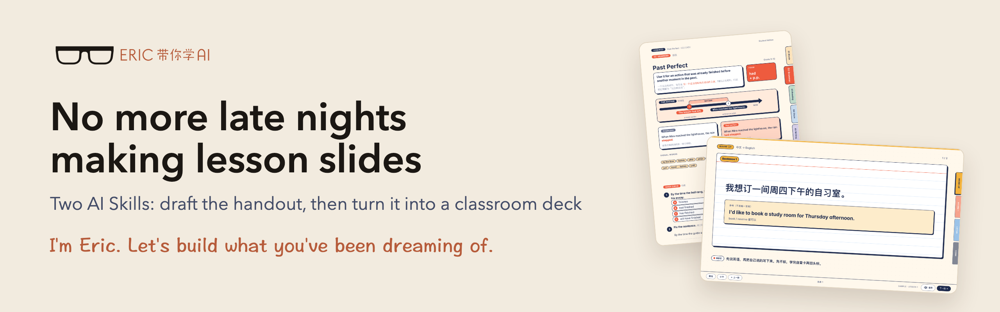

<p align="center">
  
</p>

<p align="center"><a href="README.md">中文</a>　｜　<b>English</b></p>

I used to stay up late making lesson slides. Then I started writing down the rules I care about in class, one at a time, and saved them into two Skills: one drafts the handout, the other turns that handout into the deck I teach from. Once a rule is written down clearly, the AI reads it before every new lesson, so I never have to say the same thing twice.

This is the first episode of my 「你的第一个……」 ("Your first …") series, and I'm sharing both Skills here. You can use them as they are to make your first lesson deck, or use them as a model for writing a Skill of your own, built from what you know in your own line of work.

> **What's a Skill?** A set of instructions written for an AI. It tells the AI how a certain kind of task is done, where it tends to go wrong, and how to check the result. The AI reads it every time before it starts.

## What you get

<p align="center">
  
</p>
<p align="center"><sub>Left: a handout. Right: a classroom deck. Both come from the fictional sample lessons in this repo; they are two different lessons.</sub></p>

## The two Skills

| | Handout | Classroom deck |
|---|---|---|
| **Name** | [`eric-teaching-press`](eric-teaching-press/SKILL.md) | [`eric-teaching-stage`](eric-teaching-stage/SKILL.md) |
| **What it makes** | Bilingual A4 handouts and practice, with teacher notes right next to each student task | A deck you move through beat by beat with the space bar; answers stay hidden until you click. It has timers and a listening player, and it stops you if you try to move on before the recording has played |
| **You get** | Editable Typst files and a PDF | A web page that opens with a double-click and works offline |
| **Styles** | Marginalia, Grid, Index Cards | Index Cards by default; also Marginalia, Grid, Studio, Exam |

Both are made for Chinese-speaking students learning English: the handouts are bilingual, and the deck's buttons are labeled in Chinese.

## Getting started

### 1. Pick an AI tool that can actually do things

These Skills need an AI that can read and write files on your computer and run tools on its own. The video uses WorkBuddy; other tools that can install Skills are worth a try. A chat-only AI can't run them.

### 2. Let the AI install them

Copy this message to it. It will read the instructions, check what your computer is missing, ask before installing anything, and then try the sample lesson.

```text
Please install the teaching Skills from 「Eric带你学AI」:
https://github.com/eric4umd/teaching-skills

Start by reading the repo README and both SKILL.md files,
and confirm whether you support local Skills.
If you do, install eric-teaching-press and eric-teaching-stage
into the right Skill folders.
Check for Python, Typst, Node.js and a browser;
tell me what's missing and what each one is for.
Ask me before installing software, downloading models or using any paid service.
Make one handout and one classroom deck from the built-in samples,
and check that the files open.
If a path, font or tool is missing on this machine, tell me exactly what;
skip optional features for now.
Keep my existing files; don't overwrite any Skill or lesson material
I already have.
When you're done, tell me where the files are
and how to adapt them to my own lessons.
```

If you've watched the video, you can also screenshot the install screen and send it with one line: "Follow this image."

> [!TIP]
> **Don't walk away the first time you run it.** It stops to ask before installing software or deleting temporary files, and it will wait as long as it takes for your answer.

One real run of mine: WorkBuddy V5.8.3 on a Mac, with DeepSeek V4.1 Flash as the model, and Python, Typst and Node already installed. From sending the screenshot to installing both Skills and building one sample handout and one sample deck, it worked for about 6 minutes and used about 4 credits. The Skills went into `~/.workbuddy/skills/`. Halfway through, it stopped to ask whether it could delete a temporary file; I didn't notice, so it sat there waiting for over ten minutes. The more your computer is missing, the longer it takes and the more credits it uses.

### 3. Your first lesson: handout first, then the deck

Tell it what the lesson covers. Have it draft the handout first; once you've read it and fixed what needs fixing, have it turn the handout into a classroom deck. For example:

```text
Use eric-teaching-press to make an English handout for 8th graders
on the present perfect.
Before writing, ask me about the students' level, how long the class is,
and what this lesson should achieve.
Student exercises have no answers; the teacher edition explains each item
right next to it.
Once I approve the handout, use eric-teaching-stage to turn it into
a classroom deck. I'll move through it with the space bar, and answers
appear only when I click. No listening for this lesson.
```

Swap in your own grade, topic and requirements. If you already have a lesson plan or handout, just hand it over and ask for the deck.

### 4. Check it yourself, and tell it what's wrong

Even when the AI says it has checked everything, that doesn't mean nothing is wrong. Before class, walk through it yourself:

- Open the deck with a double-click and press space from start to finish.
- Click every answer open: is it right, and is it complete?
- If there's listening, check that the player and the note-taking boxes are on the same page.
- Go through the handout's questions, answers and explanations once.

When something is off, tell it: **which page, what's wrong, what it looks like now, and what it should look like.** If you'll want it that way in every lesson, add: "Write this into the Skill's rules."

## Write a Skill of your own

These two Skills were written around my own English classes. If you teach another subject, or you're not a teacher at all, what you care about will be different.

Every time you've told an AI "that's not right," you were drawing on experience from your own line of work, something the AI can't guess on its own. Turn each one into a rule with three parts:

1. **What went wrong.** The listening player landed on the next page, so one press of the space bar and the whole recording was gone.
2. **What to do from now on.** Put the note-taking boxes and the player on the same page, and stop the teacher from moving on before the recording has played.
3. **When there's an exception, and how to check.** If the teacher really wants to skip, one more press lets them through. When testing, try that stop on purpose.

Collect a few rules like these, hand them to the AI together with a finished piece you're happy with, and ask it to write a Skill. Weekly reports, quotes, any document you rebuild every week: the same approach works.

## Software you'll need

| For | You need | Notes |
|---|---|---|
| Handouts | Python 3, Typst | Grid and Index Cards ask you to pick fonts: the original Mac fonts (fine for viewing on your own computer) or the bundled open-source fonts (portable, but the type will look different) |
| Classroom decks | Python 3 | The Marginalia theme subsets Chinese fonts to the text in each deck, which needs the Python packages fontTools and brotli |
| Opening a deck | A browser | Keep the HTML file with its folder and it opens offline; listening needs local audio generated first |
| Automatic deck checks | Node.js, Playwright and its browser | Checks page flow, answers and layout; installed separately |
| Listening audio | uv, FFmpeg, and the Python environment set up by `stage_setup.sh` | The script downloads dependencies and voice models; read it before deciding to run it |

Listening audio uses edge-tts by default, which needs an internet connection and relies on an unofficial service endpoint; check its terms before you use it. Kokoro can generate audio offline once its model files are in place. ElevenLabs is an optional paid engine; it needs your own `ELEVENLABS_API_KEY`, so check the cost first.

## Good to know

- The Skill instructions are written in English; the AI reads them either way.
- Check every handout and deck yourself before you use it in class.
- All sample lessons are fictional, and there is no student information in this repo. When you ask a question or share a screenshot, please remove student names, contact details and anything else private.

## Where things are

- `eric-teaching-press/`: the handout Skill, with Typst templates, fonts and build tools.
- `eric-teaching-stage/`: the deck Skill, with classroom components, themes, a fictional sample lesson and check scripts.

In each Skill, `SKILL.md` is where the AI starts reading; `references/` holds the details.

## Sources and licenses

Font license files sit in their font folders. The deck Skill includes GSAP 3.12.7 with its original copyright notice and license link. The fonts and GSAP each follow their own terms; see [Third-party resources](THIRD_PARTY_NOTICES.md).

I haven't chosen a license yet for my own instructions, code and layouts. Being publicly visible doesn't grant permission to redistribute them or use them commercially.

---

Made something with these? Or is there something you've always wanted to build but thought you couldn't? Tell me in the comments under the 「Eric带你学AI」 videos, or open an [issue](https://github.com/eric4umd/teaching-skills/issues) here.

**I'm Eric. Let's build what you've been dreaming of.**
