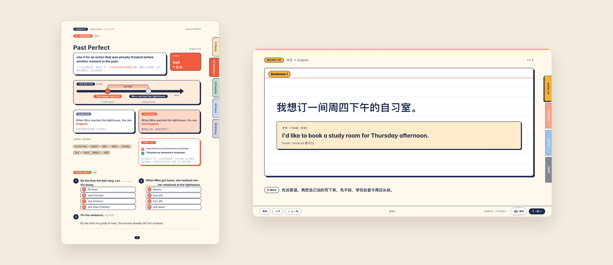

<p align="center">
  
</p>

<p align="center"><b>中文</b>　｜　<a href="README.en.md">English</a></p>

我以前常常熬夜做课件。后来，我把上课时在意的那些规则一条一条写清楚，存进了两个 Skill：一个先出讲义，一个再把讲义变成上课用的课件。规则只要写清楚一次，AI 每次做课件都会先读，同样的话，我就不用再说第二遍了。

这是「你的第一个……」系列的第一期：**你的第一个课件 Skill**。今天我把这两个 Skill 分享给大家。你可以先直接拿去，做出你的第一节课件；再把你上课在意的几条告诉 AI，做出你自己的第一个课件 Skill。

> **Skill 是什么？** 一份写给 AI 的说明。它告诉 AI 这类事情怎么做、哪里容易出错、做完怎么检查，AI 每次动手前都会先读它。

## 做出来是这样

<p align="center">
  
</p>
<p align="center"><sub>左边是讲义，右边是上课课件。两张都来自仓库自带的虚构示例课，不是同一节课。</sub></p>

## 两个 Skill

| | 讲义 | 上课课件 |
|---|---|---|
| **名字** | [`eric-teaching-press`](eric-teaching-press/SKILL.md) | [`eric-teaching-stage`](eric-teaching-stage/SKILL.md) |
| **做什么** | A4 双语讲义和课堂练习，学生的题旁边配着老师的讲解 | 老师按空格一拍一拍往下讲，答案点开才出现；带计时器和听力播放器，没听完就往下翻，会先拦住 |
| **做出来的** | 可以接着改的 Typst 文件和 PDF | 双击就能打开的网页，不联网也能用 |
| **版式** | Marginalia、Grid、Index Cards 三种 | 默认 Index Cards，另有 Marginalia、Grid、Studio、Exam |

## 怎么开始

### ① 准备一个能动手的 AI 工具

Skill 要装在能读写你电脑上的文件、能自己运行工具的 AI 里。视频里用的是 WorkBuddy，别的能装 Skill 的工具也可以试。只能在对话框里聊天的 AI，跑不了这两个 Skill。

### ② 让 AI 帮你装好

把下面这段话复制给它。它会先读说明，检查你的电脑缺什么，装东西之前先问你，装好以后拿示例课试一遍。

```text
请帮我安装「Eric带你学AI」的教学 Skills：
https://github.com/eric4umd/first-courseware-skill

先读仓库 README 和两个 SKILL.md，确认当前工具是否支持本地 Skill。
支持的话，把 eric-teaching-press 和 eric-teaching-stage 分别装到正确的 Skill 目录。
检查需要的 Python、Typst、Node.js 和浏览器；告诉我缺什么、要用来做什么。
安装软件、下载模型或调用付费服务前，先征求我的同意。
先用自带示例做一份讲义和一个课堂网页，检查文件能否打开。
遇到本机没有的路径、字体或工具，说明具体缺项；可跳过的可选功能先跳过。
保留我的原有文件，不覆盖已有 Skill 或课程成品。
最后告诉我文件保存在哪里，以及接下来怎么改成自己的课程。
```

看过视频的，也可以把视频里装 Skill 那一屏截图发给它，说一句"照这张图做"。

> [!TIP]
> **第一次跑的时候别走开。** 它装软件、删临时文件之前会停下来问你，你不点头，它就一直等着。
>
> 嫌它老问，也可以像我一样，在输入框下面把权限改成 **Allow full access**，它就不再一项一项地问了。不过这样一来，它装软件、删文件也都不会先问你，所以改之前，先确认它干活的文件夹里没有要紧的东西；做完再改回来也行。

我自己实测过一次：Mac 上的 WorkBuddy V5.8.3，模型是 DeepSeek V4.1 Flash，电脑上 Python、Typst、Node 都已经装好。从发截图，到装好两个 Skill、再用示例课做出一份讲义和一个课件，它干活用了约 6 分钟，花了 4 个积分左右，两个 Skill 装在 `~/.workbuddy/skills/`。中间它停下来问我能不能删一个临时文件，我没注意，它就在那里等了十几分钟。你的电脑缺的东西越多，用的时间和积分也会越多。

### ③ 做你的第一节课：先出讲义，再变成课件

告诉它这节课讲什么。先让它出讲义，你看过、改好，再让它做成上课用的课件。比如：

```text
请用 eric-teaching-press，给初二学生做一节英语课的讲义，主题是现在完成时。
先问我学生的基础、这节课多长时间、要达到什么目标，再开始写；学生练习不附答案，老师版在对应的题旁边讲解。
我确认讲义以后，再用 eric-teaching-stage 把这份讲义做成上课用的课件。
课件由老师按空格往下翻，答案点开才显示。这节课先不加听力。
```

把年级、主题和要求换成你自己的。手上已经有教案或讲义的，直接交给它，让它做成课件就行。

### ④ 自己验收，哪里不对就告诉它

AI 说它检查过了，也不一定就真的没问题。上课前，我们自己再走一遍：

- 双击打开课件，按空格从头走到尾；
- 每个答案都点开看一眼，对不对、全不全；
- 有听力的，看播放器和记笔记的格子在不在同一页；
- 讲义的题目、答案和讲解，从头核一遍。

哪里不对，就告诉它：**第几页、哪里不对、现在是什么样、要改成什么样**。以后每节课都要这样的，再加一句"把这一条写进 Skill 里"。

## 做出你自己的第一个课件 Skill

这两个 Skill 是照我自己的英语课写的。你教的是别的科目、别的年级，在意的地方就和我不一样。

Skill 不用你自己一个字一个字地写。你要做的，是想清楚要什么、不要什么，再告诉 AI，写这件事交给它。

**要写进去的**

- **什么时候用它**：一句话说清它是做什么的，AI 靠这一句判断该不该用。
- **你在意的那几条**：你对 AI 说过的"不对"，哪里不对、要改成什么样。比如开场那条：听力页的播放器和记笔记的格子放在同一页，没听完先拦住。
- **留给你自己定的事**：比如声音，AI 听不见，就让它先出一个试听页，由你来挑。

**不要写进去的**

- **每次都会变的**：这节课讲什么、给哪个学生上。这些留在每次对话里说。
- **太笼统的话**：比如"做得好看一点"，AI 不知道哪里算好看，做完也没法查。要说就说具体，比如"英文例句用无衬线字体，投在屏幕上要看得清"。

最省事的做法，是拿我的 Skill 当底子，对 AI 说：

```text
照 eric-teaching-stage，帮我做一个我自己的课件 Skill。
我教〔科目、年级〕，〔怎么上课，比如线上一对一〕。
我在意这几条：
1. 〔哪里不对，要改成什么样〕
2. 〔……〕
这些事留给我自己定：〔比如例句、题目难度〕。
写好以后，用它做一节〔新的一节课〕给我看。
```

用的时候发现不对，就告诉它：第几页、现在是什么样、要改成什么样，再加一句"把这一条写进 Skill 里"。不用一开始就写全，先写你最在意的几条，用一次，改一条。

不是老师也一样：周报、报价单，每周都要重做的同一类文件，都可以这样做一个你自己的 Skill。

## 要用到的软件

| 用来 | 需要 | 说明 |
|---|---|---|
| 出讲义 | Python 3、Typst | Grid 和 Index Cards 要先选字体：Mac 原来的字体（只适合在自己电脑上看），或者随附的开源字体（换台电脑也能用，字形会变） |
| 做课件 | Python 3 | Marginalia 主题会按课件里的字做中文字体子集，要用到 Python 的 fontTools 和 brotli |
| 打开课件 | 浏览器 | 网页和旁边的文件夹放在一起，不联网也能打开；听力要先生成本地音频 |
| 自动检查课件 | Node.js、Playwright 和它的浏览器 | 检查翻页、答案和排版，需要另外安装 |
| 生成听力 | uv、FFmpeg，以及 `stage_setup.sh` 装的 Python 环境 | 脚本会下载依赖和语音模型，先读一遍再决定要不要运行 |

听力默认用 edge-tts，生成时要联网；它走的是非官方接口，用之前请自己看一下服务条款。Kokoro 的模型准备好以后，可以离线生成。ElevenLabs 是可选的付费方案，需要自己配置 `ELEVENLABS_API_KEY`，用之前先确认费用。

## 要知道的

- 两个 Skill 的说明是英文写的，AI 读得懂，不影响用。
- AI 做出来的讲义和课件，上课前请自己从头检查一遍。
- 示例课都是虚构的，仓库里没有学生信息。你提问题、贴截图的时候，也请先删掉学生姓名、联系方式和其他私人信息。

## 文件在哪里

- `eric-teaching-press/`：讲义 Skill，有 Typst 模板、字体和编译工具。
- `eric-teaching-stage/`：课件 Skill，有课堂组件、主题、虚构示例课和检查脚本。

每个 Skill 的 `SKILL.md` 是 AI 读的入口，`references/` 里是详细说明。

## 来源与许可

字体的许可文件放在各自的字体文件夹里。课件 Skill 里带了 GSAP 3.12.7，保留了原来的版权声明和许可链接。字体和 GSAP 各自遵循自己的条款，详见[第三方资源说明](THIRD_PARTY_NOTICES.md)。

我原创的说明、代码和版式，暂时还没有选定统一的开源许可证；公开可见，不等于授权再分发或商用。

---

你用它做出了什么，或者有什么一直想做、却总觉得自己做不到的东西，欢迎到「Eric带你学AI」的视频评论区告诉我，也可以在这里提一个 [Issue](https://github.com/eric4umd/first-courseware-skill/issues)。

**我是 Eric，和你一起，构建你心中的梦。**
